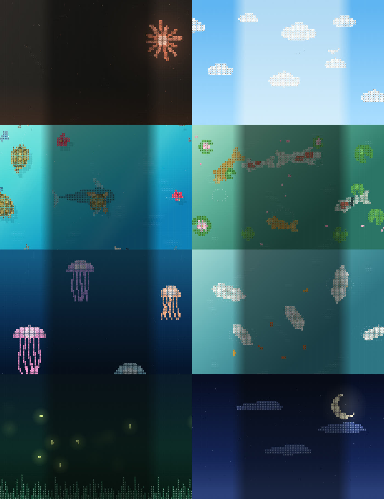

# ASCII Wallpapers for Claude Code

Eight live ASCII wallpapers behind the chat in Claude Desktop. Each scene is painted in character cells that shimmer and move, and the window's panels turn to frosted glass over it, so the chat stays easy to read.



**Claude Code** · **Cloud Drift** · **Honu Lagoon** · **Koi Pond** · **Jellyfish** · **Paper Boats** · **Fireflies** · **Moonlit**

From the concept film on X: https://x.com/handsher_NGU/status/2121399044560015748

## Install

Needs Claude Code 2.1.325 or later (`claude --version`; `claude update` to get it). The wallpapers draw in the **Code tab of Claude Desktop** (and the mobile app), not in a terminal.

At the prompt of a terminal session of Claude Code:

```
/plugin install ascii-wallpapers --marketplace Handsher/ascii-wallpapers
```

Answer `y` to add the marketplace, then pick a scope (user scope puts it in every session).

From a shell:

```bash
claude plugin install ascii-wallpapers --marketplace Handsher/ascii-wallpapers
```

In the desktop app, where `/plugin` does not run: click **+** next to the prompt box, then **Plugins**, **Add marketplace** with `Handsher/ascii-wallpapers`, then **Add plugin**.

Then start a new session in the Code tab of Claude Desktop.

## Use

- `/wallpaper` opens the picker above the prompt. Click a wallpaper (or focus the picker and press 1–8, 0 for off). Clawd the crab sits on it and hops when you pick one.
- `/wallpaper honu` (or any name), `/wallpaper off`.
- `/wallpaper crab off` sends Clawd to rest; `/wallpaper crab on` brings him back.
- Your pick is kept for the next session.

## Notes

- Wallpapers draw in Claude Desktop (and the mobile app); the terminal keeps its own look.
- One theme at a time: turn off any other plugin that sets a theme.
- On an older Claude Code, `/wallpaper` says to update instead of failing.
- The scenes are SVG with SMIL motion, generated from the concept film's own scene code.

## Remove

```bash
claude plugin uninstall ascii-wallpapers
```

MIT License.
